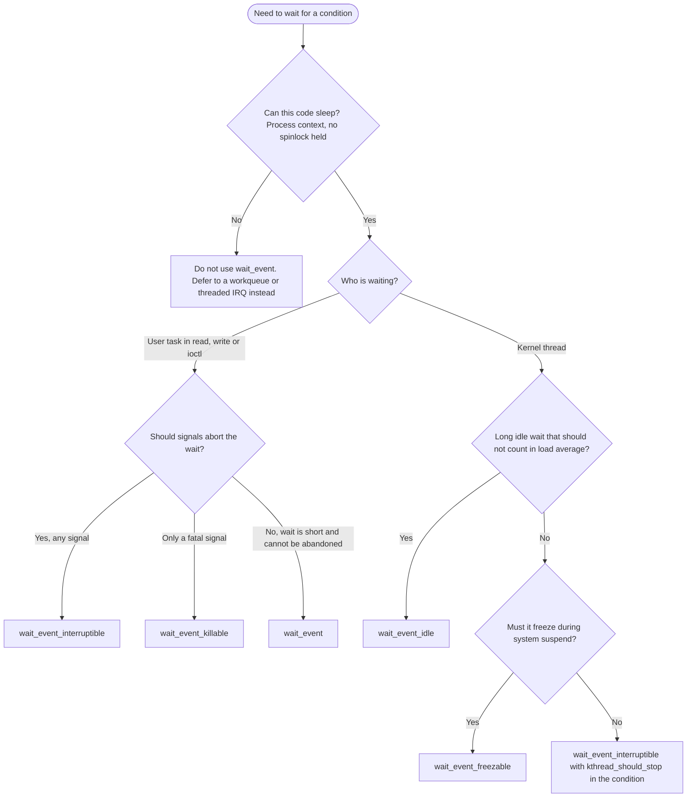
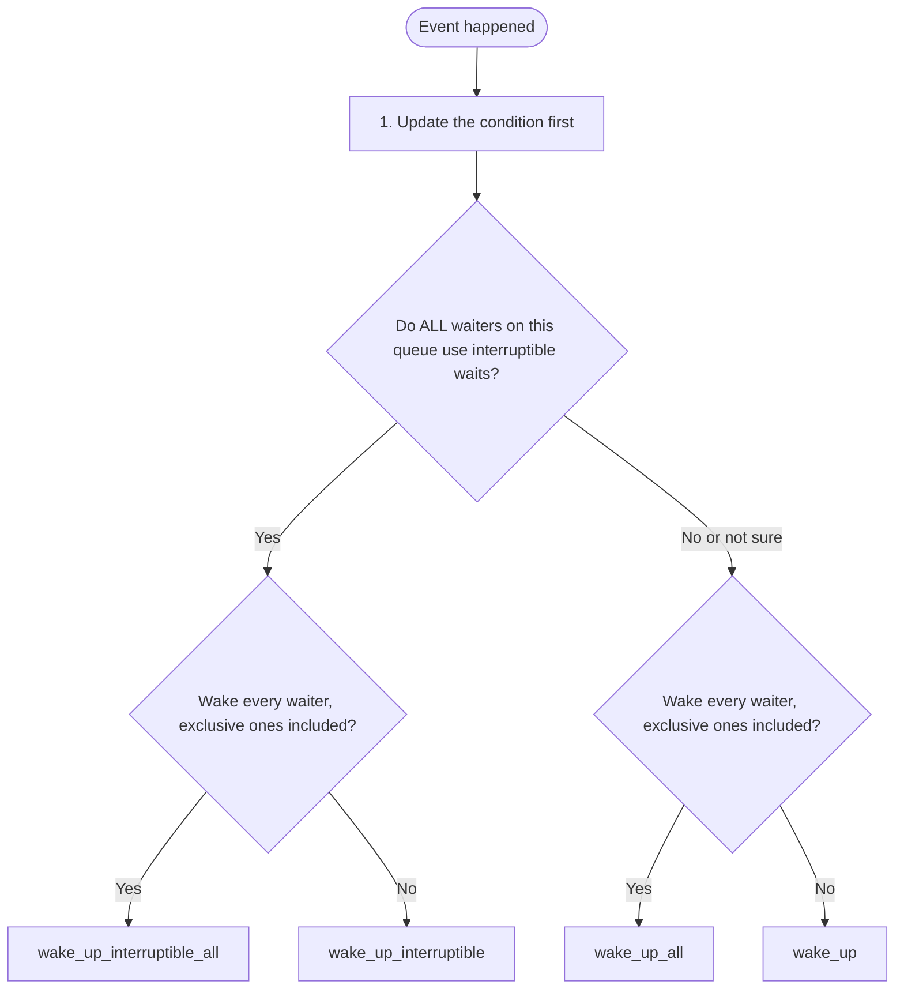

# Waiting and waking up mechanisms in kernel

* Term sleeping refers to a mechanism by which a task (on behalf of running kernel code) voluntarily relaxes processor with possibility of another task being scheduled.

* There are two sleeeping mechanisms in linux kernel:
    - **Simple sleeping**
        - Waking up from sleep is implicit after the sleep duration expires
    - **Sleeping based on a conditional event**
        - Another task must explicitly wake up the sleeping task based on a condition
        - Alternatively a sleeping timout can be specified, after which the sleeping task wakes up even if the condition was not set to true
        - **Note**: If no timeout is specified and the condition never became true, then the task sleeps forever

* Fundamentally the difference between the two mechanisms is how the waking up happens:
* **Simple sleeping** in kernel is implemented using a dedicated sleep API.
* **Conditional based sleeping** in kernel is implemented using a wait queue.
* In this document we will look at conditional based sleeping and in the [next document](6-Simple-Sleeping.md) the mechanism of simple slpeeing will be discussed in detail. 

## Wait queue
* Kernel scheduler manages a list of tasks to run (tasks in `TASK_RUNNING` state). This list is known as *runqueue*.
    - Tasks can be interruptible having flag `TASK_INTERRUPTIBLE` set.
    - For uninterruptible tasks, the flag `TASK_UNINTERRUPTIBLE` set.
* Sleeping tasks have their own queue called *wait queue*
* Wait queues are higher level mechanisms essentially used for one of the following:
    - process blocking input/output (I/O).
    - to wait for a condition to be true.
    - to wait for a given event to occur.
    - to sense data or resource availability.
* Structure of wait queue defined in `include/linux/wait.h` looks something like:

```c
struct wait_queue_head {
    spinlock_t lock;
    struct list_head head;
};
```
* Thus wait queue data structure consists of the following:
    - a list which consists of sleeping process waiting to be awakend
    - a spinlock to protect access to this list
* Wait queue can therefore be used when more than one process wants to sleep.
    - In other words, each process that wants to sleep while waiting for the event to occur puts itself in this list before going to sleep.
    - While a process is in the list, it is called wait queue entry. 
    - When an event occurs, one or more process on the list are woken up and moved off the list.
* Wait queue data structure only remembers which process sleeps in it but doesn't store or examine whether the wake up condition is true or false.
## Two methods of declaring and initializing wait queue

1. **Static initialization**: Use `DECLARE_WAIT_QUEUE_HEAD` macro
```c
DECLARE_WAIT_QUEUE_HEAD(wq);
/*equivalent to: wait_queue_head_t wq = some_static_init_steps;
```

2. **Dynamic Initialization**: Use `init_waitqueue_head()`:
```c
wait_queue_head_t wq;

/* wq is embedded in a per device struct */
struct my_dev {
    wait_queue_head_t wq;
    bool data_ready;
};
...
...
/* initialize the wait queue in some other part of the kernel module 
* may be a different function in same file or a different file
*/
init_wait_queue_head(&my_dev->wq);
```
* **NOTE** This has the same  trade-off as `DEFINE_SPINLOCK`and `spint_lock_init()` covered in [Advantages and disadvantages of static vs dynamic spinlock creation](2-SpinLocks.md#advantages-and-disadvantages-of-static-and-dynamic-creation-of-spinlocks)

## Details
### Putting to sleep via `wait_event*` API calls 
* Any process/task that wants to sleep while waiting for an event to trigger so that the process/task can wake up
* Most of the time the event is availability of a resource or a condition to become true
    - Thus before a task going to sleep, it makes sense to check the condition (or resource availbility) before the task is put to sleep.
* The kernel API that puts the task to sleep also accepts a condition.
*  There are four kernel api's for putting task(s) to sleep:
    - `wait_event(&wq, condition)`: puts the process/task to `TASK_UNINTERRUPTIBLE`
    - `wait_event_interruptible(&wq, condition)`: puts the process/task to `TASK_INTERRUPTIBLE` state.
    - `wait_event_killable(&wq, condition)` : puts the task/process to `TASK_KILLABLE` state.
    - `wait_event_timeout(&wq, condition, timeout)`: same as `wait_event` but allows for a timout after which the task can wait
    - `wait_event_timeout_interruptible()`: same as `wait_event` but allows for a timout after which the task can wait
* The `wait_event_timeout(&wq, condition, timeout)`: has two behaviors depenending on the timeout having elapsed or not. These are
    - **Timeout elapsed** : 
        - function returns 0 if `condition` evaluated to `false`
        - function returns 1 if `condition` evaluated to `true`
    - **Timeout not elapsed yet**: Function returns remaining time (in `jiffies`, at least 1 , more on this later) if the `condition` evaluates to `true`
*  Internally all the flavors of `wait_event` does the following
    - it checks the condition (on resource availability for eg).
    - if `true`, then the task is not put to sleep and a can continue execution.
    - if `false` then the flag `TASK_(UN)INTERRUPTIBLE` flag is set and `schedule()` is called  on the task (which removes the task from the run queue, and the task is put to sleep)
    - here's  a simple code snippet of what happens internally in one of `wait_event*`function: 
    ```c
    for (;;) {
        prepare_to_wait_event(&wq, &entry, state);   /* add to wait queue, set task state */

        if (condition)  /* condition true, done waiting */
            ret = 0;
            break;

        /* checks only interruptible variants:
        *  after check of condition and then check 
        *  for an interrupt signal 
        */
        if (state == TASK_INTERRUPTIBLE && signal_pending(current)) /* signal arrived, give up waiting */
        {
            ret = -ERESTARTSYS;
            break;
        }

        schedule();                                  /* sleep until somone wakes up the task */
    }
    finish_wait(&wq, &entry);                        /* back to TASK_RUNNING, remove from queue */
    ```
### Waking up a task in sleep state via `wake_up*` API Calls
* After the change in `condition` or an interrupt (or kill) signal the appropriate `wake_up*` family of function should be called.
    - `wake_up()/wake_up_all()`: wakes up one or all the tasks in the event queue
    - `wake_up_interruptible()/wake_up_interruptible_all()`
* After waking up the task, the task has a corresponding flag set 
    - `TASK_NORMAL` : if the regular. 
* The taks that `wake_up*` family functions can wake up doesn't depend on which `wait_event*` functions were used to put the task to sleep but depends on the state of the task (for eg `TASK_UNINTERRUPTIBLE` vs `TASK_INTERRUPTIBLE` vs `TASK_KILLABLE` etc). 
* Table below summarizes the state of  task set by `wait_event*` function and consequently which `wake_up*` function can be used to wake up the task

| Waiter sleeps with                                                           | Task state                                                 | `wake_up()` / `wake_up_all()` | `wake_up_interruptible()` / `wake_up_interruptible_all()` |
|------------------------------------------------------------------------------|------------------------------------------------------------|-------------------------------|-----------------------------------------------------------|
| `wait_event()`                                                               | `TASK_UNINTERRUPTIBLE`                                     | Yes                           | No                                                        |
| `wait_event_timeout()`, `wait_event_hrtimeout()`                             | `TASK_UNINTERRUPTIBLE`                                     | Yes                           | No                                                        |
| `wait_event_interruptible()`                                                 | `TASK_INTERRUPTIBLE`                                       | Yes                           | Yes                                                       |
| `wait_event_interruptible_timeout()`, `wait_event_interruptible_hrtimeout()` | `TASK_INTERRUPTIBLE`                                       | Yes                           | Yes                                                       |
| `wait_event_freezable()`                                                     | `TASK_INTERRUPTIBLE` (freezable)                           | Yes                           | Yes                                                       |
| `wait_event_killable()`                                                      | `TASK_KILLABLE` (uninterruptible + wakes on fatal signal)  | Yes                           | No                                                        |
| `wait_event_idle()`                                                          | `TASK_IDLE` (uninterruptible, not counted in load average) | Yes                           | No                                                        |

* Hence it can be observed from the table above that 
    - the `wake_up()` and `wake_up_all()` can wake up tasks that are in any one of  `TASK_UNINTERRUPTIBLE` or `TASK_INTERRUPTIBLE` or `TASK_KILLABLE` or `TASK_IDLE` state.
    - the `wake_up_interruptible()` or `wake_up_interruptible_all()` can only wake up tasks that in  `TASK_INTERRUPTIBLE_STATE`

* When the `wake_up*` family functions wakes up the tasks, it updates the states of task again based on which `wake_up*` variant woke the task, described in the table below: 

| Wake function                 | Wakes sleepers in state                          | How many                                               |
|-------------------------------|--------------------------------------------------|--------------------------------------------------------|
| `wake_up()`                   | `TASK_NORMAL` (interruptible or uninterruptible) | All non-exclusive waiters + at most 1 exclusive waiter |
| `wake_up_all()`               | `TASK_NORMAL`                                    | All waiters, exclusive ones included                   |
| `wake_up_interruptible()`     | `TASK_INTERRUPTIBLE` only                        | All non-exclusive waiters + at most 1 exclusive waiter |
| `wake_up_interruptible_all()` | `TASK_INTERRUPTIBLE` only                        | All waiters, exclusive ones included                   |

* For the interrup
### Fine Details

* `wait_event_interruptible` doesn’t allow interruption of the task in any destructive sense. 
* It puts the task to sleep in a state where it can be woken up, either by means of `condition`becoming true or by a signal. That’s what “interruptible” means.
    - When the `condition` is true, the `wait_event_interruptible`
* Consider the snippet
```c
static DECLARE_WAIT_QUEUE_HEAD(my_event);   /* the wait queue head */
static bool data_ready;                     /* the condition */

/* reader */
ret = wait_event_interruptible(my_event, READ_ONCE(data_ready));
if (ret)
    return ret;                             /* -ERESTARTSYS: signal arrived */

/* writer / producer */
WRITE_ONCE(data_ready, true);               /* 1. condition first */
wake_up_interruptible(&my_event);           /* 2. then wake sleepers */
```
 - combining it with the simplified snippet from the `wait_event*` above , following can happen when a task is under sleep quue and/or woken up by `wake_up*` or a signal:

 | Waiter                       | Situation                                                                                           | Blocked or returns?                                                  | What the wait call returns            |
|------------------------------|-----------------------------------------------------------------------------------------------------|----------------------------------------------------------------------|---------------------------------------|
| `wait_event_interruptible()` | `data_ready` is already `true` when the call runs                                                   | Returns immediately. The task never sleeps and no wake-up is needed. | `0`                                   |
| `wait_event_interruptible()` | `data_ready` is `false`                                                                             | Blocks. The task sleeps until woken.                                 | Nothing yet (still inside the call)   |
| `wait_event_interruptible()` | `wake_up_interruptible()`, `wake_up()` or `wake_up_all()` arrives and `data_ready` is `true`        | Returns. Re-checks the condition and finds it true.                  | `0`                                   |
| `wait_event_interruptible()` | `wake_up_interruptible()`, `wake_up()` or `wake_up_all()` arrives but `data_ready` is still `false` | Stays blocked. Re-checks, finds it false, and goes back to sleep.    | Nothing yet (still inside the call)   |
| `wait_event_interruptible()` | A signal arrives (for example Ctrl+C) while the condition is false                                  | Returns, with no wake-up involved.                                   | `-ERESTARTSYS`                        |
| `wait_event()`               | `data_ready` is already `true` when the call runs                                                   | Returns immediately. The task never sleeps and no wake-up is needed. | No value (it is a `void`-style macro) |
| `wait_event()`               | `data_ready` is `false`                                                                             | Blocks. The task sleeps until woken.                                 | Nothing yet (still inside the call)   |
| `wait_event()`               | `wake_up()` or `wake_up_all()` arrives and `data_ready` is `true`                                   | Returns. Re-checks the condition and finds it true.                  | No value (it is a `void`-style macro) |
| `wait_event()`               | `wake_up()` or `wake_up_all()` arrives but `data_ready` is still `false`                            | Stays blocked. Re-checks, finds it false, and goes back to sleep.    | Nothing yet (still inside the call)   |
| `wait_event()`               | `wake_up_interruptible()` or `wake_up_interruptible_all()` arrives, even with `data_ready` `true`   | Stays blocked. An uninterruptible sleeper is not woken by these.     | Nothing yet (still inside the call)   |
| `wait_event()`               | A signal arrives (for example Ctrl+C)                                                               | Stays blocked. It cannot be interrupted by signals.                  | Nothing yet (still inside the call)   |

# Clarifying the role of `schedule()`
* From the above discussions, it might be easy have a misunderstanding on the role of scheduler. The call to `schedule()` neither schedules the task to go to sleep nor schedules the to go to runqueue. 
* The scheduler simply picks the next task to run on the CPU by observing the state of the task.
    - If the state of the task is `TASK_RUNNING` then the scheduler leaves the task in the run queue.
        - this task may run immediately or after sometime depending on the run queue
    - If the state of the task is `TASK_INTERRUPTIBLE` or `TASK_UNINTERRUPTIBLE` the scheduler removes the task from the run queue.
* After scheduler has finished processing the task, it context switches to some other runnable task.

## Who puts the task to run queue
* Not `schedule()` but the waker does
    - `wake_up()` calls `try_to_wake_up()` which sets the state back to `TASK_RUNNING` and enqueues it to a runqueue.
    - A signal does the same for task interruptible task
# Summary

## Wait queues: which `wait_event*` and which `wake_up*`?

### Mental model: three questions

1. **Can the wait be aborted by a signal?** This picks the `wait_event*` variant.
2. **How long may it wait?** Forever, or with a timeout.
3. **Who wakes it, and with which function?** The wake-up must match the sleeper's state.

Golden rules:

- Set the condition **first**, then call `wake_up*()`.
- A wake-up only makes the sleeper re-check. If the condition is still false, it sleeps again.
- `wait_event*` can sleep, so never call it from an interrupt handler or while holding a spinlock. `wake_up*()` is safe from interrupt context.
- Always check the return value of the `_interruptible`, `_killable` and `_timeout` variants.

### 1. Choosing the wait function



Then add a modifier if needed:

| If you also need...                                        | Use this form                                                                                                       | Why                                                                                                        |
|------------------------------------------------------------|---------------------------------------------------------------------------------------------------------------------|------------------------------------------------------------------------------------------------------------|
| A timeout                                                  | `..._timeout()` (jiffies) or `..._hrtimeout()` (`ktime_t`)                                                          | Avoids waiting forever on hardware that may never respond.                                                 |
| The condition checked under a spinlock                     | `wait_event_lock_irq()` and `wait_event_interruptible_lock_irq()` (check the exact names in `include/linux/wait.h`) | The lock is held while the condition is evaluated and dropped while sleeping.                              |
| Many waiters where one event should serve only one of them | `wait_event_interruptible_exclusive()` and friends                                                                  | Avoids waking everyone (thundering herd). Pair with plain `wake_up*()` so only one exclusive waiter wakes. |

### 2. The wait variants at a glance

| Variant                                                          | Sleep state                     | What ends the wait                                                    | Returns                                                 | Use when                                                                                                                       |
|------------------------------------------------------------------|---------------------------------|-----------------------------------------------------------------------|---------------------------------------------------------|--------------------------------------------------------------------------------------------------------------------------------|
| `wait_event()`                                                   | `TASK_UNINTERRUPTIBLE`          | Condition true only (signals are ignored)                             | Nothing (`void`)                                        | The wait is short and you cannot back out. Long waits show up as `D` state and can trigger hung-task warnings (default 120 s). |
| `wait_event_interruptible()`                                     | `TASK_INTERRUPTIBLE`            | Condition true or any signal                                          | `0` / `-ERESTARTSYS`                                    | **Default for `read`/`write`/`ioctl` handlers** so Ctrl+C works.                                                               |
| `wait_event_killable()`                                          | `TASK_KILLABLE`                 | Condition true or a fatal signal                                      | `0` / `-ERESTARTSYS`                                    | Ordinary signals must not abort the wait, but the task must stay killable.                                                     |
| `wait_event_timeout()`                                           | `TASK_UNINTERRUPTIBLE`          | Condition true or timeout (jiffies)                                   | `0` = timed out, condition false; `>0` = condition true | Bounded wait for hardware that cannot be aborted.                                                                              |
| `wait_event_interruptible_timeout()`                             | `TASK_INTERRUPTIBLE`            | Condition, timeout or signal                                          | `0` / `>0` / `-ERESTARTSYS`                             | Bounded and abortable wait in a syscall handler.                                                                               |
| `wait_event_hrtimeout()`, `wait_event_interruptible_hrtimeout()` | Uninterruptible / interruptible | Condition, `ktime_t` timeout (and a signal for the interruptible one) | `0` / `-ETIME` (plus `-ERESTARTSYS` if interruptible)   | Timeout finer than the jiffy tick.                                                                                             |
| `wait_event_idle()`                                              | `TASK_IDLE`                     | Condition true only                                                   | Nothing (`void`)                                        | Kernel threads that sit idle for long periods and must not inflate the load average.                                           |
| `wait_event_freezable()`                                         | `TASK_INTERRUPTIBLE`, freezable | Condition, signal, or freeze for suspend                              | `0` / `-ERESTARTSYS`                                    | Kernel threads that must not block system suspend.                                                                             |

### 3. Choosing the wake function



| Function                      | Wakes sleepers in state     | How many                                | Use when                                                                        |
|-------------------------------|-----------------------------|-----------------------------------------|---------------------------------------------------------------------------------|
| `wake_up()`                   | Any sleeper (`TASK_NORMAL`) | All non-exclusive + at most 1 exclusive | **Safe default.** Mixed waiters, or you are not sure.                           |
| `wake_up_all()`               | Any sleeper                 | All, exclusive ones included            | Broadcast events: shutdown, device removal, state change relevant to everybody. |
| `wake_up_interruptible()`     | `TASK_INTERRUPTIBLE` only   | All non-exclusive + at most 1 exclusive | Every waiter on this queue uses an `_interruptible` wait.                       |
| `wake_up_interruptible_all()` | `TASK_INTERRUPTIBLE` only   | All, exclusive ones included            | Same as above, broadcast.                                                       |

### 4. Which wake-up reaches which waiter

| Waiter used                                                                       | `wake_up()` / `wake_up_all()` | `wake_up_interruptible()` / `wake_up_interruptible_all()` |
|-----------------------------------------------------------------------------------|-------------------------------|-----------------------------------------------------------|
| `wait_event()`, `wait_event_timeout()`, `wait_event_hrtimeout()`                  | Wakes it                      | **Does not wake it**                                      |
| `wait_event_killable()`                                                           | Wakes it                      | **Does not wake it**                                      |
| `wait_event_idle()`                                                               | Wakes it                      | **Does not wake it**                                      |
| `wait_event_interruptible()` and its `_timeout`, `_hrtimeout`, `_freezable` forms | Wakes it                      | Wakes it                                                  |

Signals are separate: they wake `_interruptible` and `_killable` sleepers on their own, whatever wake function you use.

### 5. Common mistakes

- Calling `wake_up_interruptible()` for a `wait_event()` or `wait_event_killable()` waiter. It never wakes, and the task sleeps on.
- Waking without setting the condition, or setting the condition without waking. A sleeping task needs both.
- Putting side effects in the condition (`counter++`, consuming an item). It runs many times.
- Ignoring `-ERESTARTSYS`. Release what you took and return it unchanged, unless you already made progress (then return the partial count).
- With several consumers, not re-checking the condition under your lock after waking.
- Using plain `wait_event()` for long waits. The task cannot be interrupted and may trigger hung-task warnings.

### One-line cheat sheet

> Syscall handler: `wait_event_interruptible()` + `wake_up_interruptible()` (or `wake_up()`). Unsure about the mix of waiters: `wake_up()`. Need a timeout: add `_timeout`. Broadcast: `_all`.