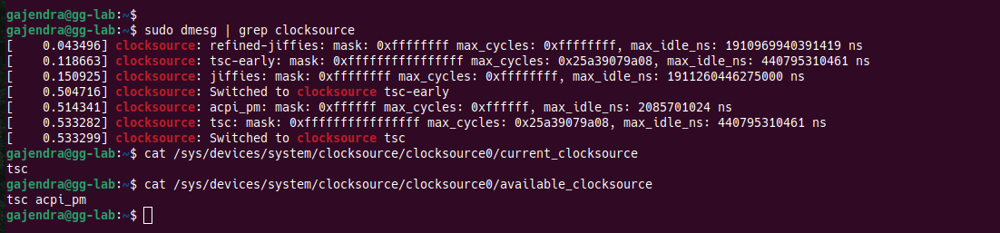
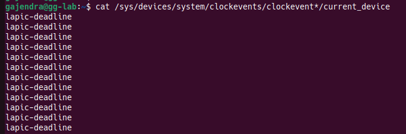
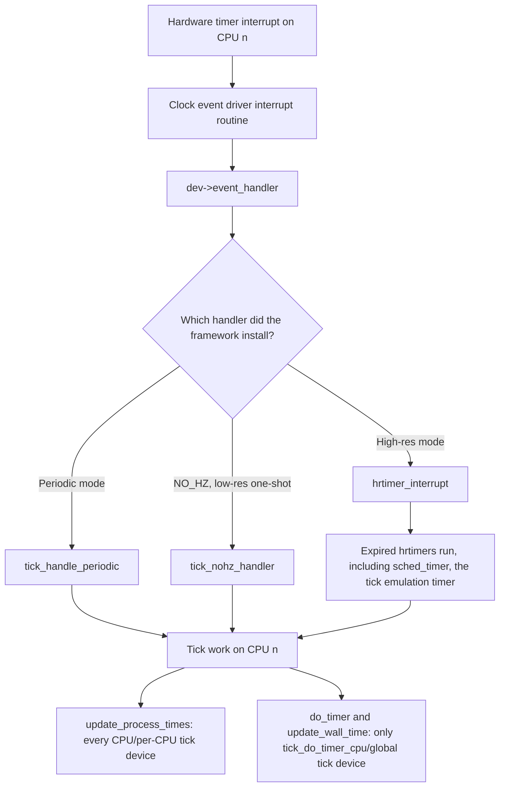

# Linux Kernel Time Management
* After memory, time is one of the most used resources in computer systems
* It is used for almost everything:
    - timer, sleep, scheduling, and many more
* Linux Kernel includes software timer concepts to enable kernel functions to be invoked at a later time.

## Clock source, clockevent and tick device
* In linux kernl, the timer system was programmed to fire interrupts periodically at **HZ**  frequency (more on **HZ** bleow).
* The corresponding preiod is called **jiffy** (more on **jiffy** blow).s
* Each of the interrupts (think of interrupt as an event) generated is called a **tick** and is generated in $\frac{1}{HZ} seconds$.
* The system time management in linux kernel in eralier days was bound to `jiffies` which is a global variable in kernel.
    - the jiffies values is incremented based on the subsequent *ticks*
* Additionally, a tick handler was responsible for process scheduling, statistic updating and profiling

### `jiffy`, tick  and HZ explained

#### Linux Kernel Terminology: Jiffies
* **jiffy** : In Linux kernel terminology, a **jiffy is the unit of time between two consecutive system timer interrupts (ticks)**. 
    - It acts as the fundamental "heartbeat" of the software clock maintained by the kernel. 
* **tick**: In kernel hardware timer interrupt firing event is called tick. 
* The time elapsed beween  

#### 1. The Relationship with `HZ`
* Concretley `**HZ**` in linux kernel is a compile time constant defined in the kernel configuration file. 
* The actual duration of a jiffy depends entirely on a compile-time constant called **`HZ`**, which dictates the frequency of the hardware timer interrupts per second. 
* **Calculation:** The duration of a single jiffy is exactly $\frac{1}{HZ}$ seconds.
    - For eg if HZ is 1000, then $jiffy = \frac{1}{1000} = 0.001s = 1 milliseconds$
* **Variability:** The `HZ` value varies depending on the hardware architecture and kernel configuration. Historically, it was set to 100 on x86 architectures (making a jiffy **10 milliseconds**). In later kernels, it was increased to 1000 (**1 millisecond**), and modern x86 kernels often default to 250 (**4 milliseconds**) to balance scheduling responsiveness with performance overhead.
* On a running linux machine, the HZ value can be observed by the following:
```sh
grep 'CONFIG_HZ=' /boot/config-$(uname -r)
``` 

#### 2. The `jiffies` Counter
* The kernel maintains a **global variable** named **`jiffies`** (declared in `<linux/jiffies.h>`). 
* Every time a hardware timer interrupt fires, the kernel increments this counter by 1.
* The variable essentially stores the total number of clock ticks that have elapsed since the system booted. 

#### 3. Data Type and the 64-bit Overlay
* Because `jiffies` increments constantly, a standard 32-bit integer would overflow (wrap around to zero) relatively quickly (in about 49.7 days if `HZ=1000`). s
    - To prevent this, the kernel implements a clever architecture:
* It declares a 64-bit variable named `jiffies_64`.
* On 32-bit systems, the linker script overlays the standard `unsigned long jiffies` directly on top of the lower 32 bits of `jiffies_64`. 
* Most kernel code only checks time differences over short periods and reads the fast 32-bit `jiffies` variable, while timekeeping subsystems use the full `jiffies_64` to avoid long-term overflow.

#### 4. Modern Context: `NO_HZ` (Tickless Kernel)
* In older Linux kernels, the timer interrupt would fire ruthlessly at the `HZ` rate, even if the CPU was completely idle, wasting energy. 
* Modern Linux configurations use a mechanism called `NO_HZ` (a tickless kernel). 
* When a CPU goes idle, the kernel dynamically suppresses the periodic timer interrupt, waking up only when an actual event or scheduled timer requires attention. 
* This dramatically saves power on modern processors and mobile devices.

## hrtimers or High Resolution Timers
* Because `jiffies` are not accurate down to micro or noano sceconds with chip advancement and procssor evolution, hrtimers were introduced
    - this was done in backward compatible manner to not break the existing APIs
    - hrtimers can meaure time interval with nanoseconds accuracy (since processor speeds now clock to several GHz)

* Starting from kernel version 2.6.21, as first improvement, high resolution or *hrtimers*  implementation was merged.
    - Can be configured through `CONFIG_HIGH_RES_TIMERS`
    - On currently running linux machine, this can be examined by
    ```sh
    cat /boot/config-`uname -r` | grep "CONFIG_HIGH_RES_TIMERS"
    ```
* As a result of hrtimersand its transparent (or backward compatible integration) there are following points and advantages of hrtimer to keep in mind:
    -  the existing user space applications keep working as its, but with better time accuracy.
    - **New data type `ktime_t`** holding time value in nanoseconds. 
    - **Old time implementation stayed**: the tick-based, low-res timer (jiffy) still exists.
* The follwoing API's were converted to use hrtimers
    - `nanosleep()`
    - interval timers (`itimers`, `settimer()`)
    - POSIX Timers: `time_create()` and firends
    - **`nanosleep()` and `clock_nanosleep()` were unified**. This became possible after `nanosleep()` and the POSIX timers were both converted to hrtimers.
    - **Without hrtimers**, the best accuracy for a timer event would be **one jiffy**, and the length of a jiffy depends on `HZ`, the kernel's tick rate.

* A timer that can only fire on a tick can be late by up to one jiffy. An hrtimer is programmed to fire at the exact requested time, limited by the hardware timer.
* For eg `msleep()` is built on jiffies whereas `usleep_range()` is built on hrtimers. 
    - this is the reason whay `usleep_range()` is better choice over `msleep()` as it provides better granularity
### Low-res vs high-res timers

| | Low-resolution (jiffy-based) | High-resolution (hrtimer) |
|---|---|---|
| Time unit | Jiffies (ticks) | Nanoseconds (`ktime_t`) |
| Accuracy | About one jiffy | Limited by the hardware timer, far better than a jiffy |
| Needs `CONFIG_HIGH_RES_TIMERS`? | No | Yes |
| Typical kernel users | Timeouts, `msleep()` | `usleep_range()`, `hrtimer_start()`, POSIX timers, `nanosleep()` |

### Check on running linux machine machine

```bash
grep -E 'CONFIG_HZ=|CONFIG_HIGH_RES_TIMERS' /boot/config-$(uname -r)   # 
sudo grep -i resolution /proc/timer_list | head    # "1 nsecs" means high-res mode is active
## or 
sudo cat  /proc/timer_list | head
```
## Clocksource framework and clock source devices
* A **clock source** is monotonic, atomic and free-running counter.
* This can be considered as a timer that acts as a free running counter that provides time stamping and read access to monotonically increasing time value.
* In simple words : A clocksource is a free-running hardware counter that the kernel reads to answer “how much time has passed?"

* The most common operation performed on clock source devices is reading the counter's value
* In kernel, there is a `clocksource_list` , a global ist that tracks the clock source deivces registered with the system
    - they are enqueued ordered by rating
    - this allows the linux kernel to know about all registered clock source deivce
    - also this allows kernel to switch to the best clock source with better ratings and features
* **How the selection works**
    - A clock source needs to be registered with kernel by invoking `clock_source_mmio_init()` or `clocksource_register_hz()` 
    - The function `__clocksource_select()` function is invoked after each registration of a new clock source
    - this ensures that the best clock source is always selected .

* Commands to explore clocksource
    - Check available clock source
    ```sh
    cat /sys/devices/system/clocksource/clocksource0/available_clocksource
    ```
    - Check current clock source
    ```sh
    cat /sys/devices/system/clocksource/clocksource0/current_clocksource
    ```
    - Check clocksource message from bool
    ```sh
    sudo dmesg | grep clocksource
    ```
    - To change the current clock source (caution), the following command can be executed
    ```sh
    echo acpi_pm > /sys/devices/system/clocksource/clocksource0/current_clocksource  # run with caution and only on a VM
    ```
###  Sample output from `dmesg | grep clocksource` explained
* Following sample output was observed on my machine from the boot logs for clock source  
  

* In the first line of the output, it can be seen that the system registers `refined-jiffies`
    - This is available very early on during bootup
    - can be used as as a fallback clock source.
* In the second line it can be seen that the `tsc-early` clock source is registered. 
    - This is the CPUs time stamp counter is registered
    - has an early rough calibration (what does this mean ?)
* In third line the `jiffies` clock source is registered. 
    - This is the lowest quality tick based fallback.
* In the fourth line the boot logs say `Switched to clocksource tsc-early`
    - this happened becuase of all the three clock source `tsc-early` is the best one so far
* In 5th line acpi_pm or the ACPI Power managment timer was registerd.
    - because it is slower to read than `tsc-early`, it is not chosen 
* Next `tsc` was registerd
    - this has higher rating thatn `tsc-early`
* In the last line, the kernel switched from `tsc-early` to `tsc` and stayed on this clock source
    - this can be verified by `cat /sys/devices/system/clocksource/clocksource0/current_clocksource`

## Linux kernel timekeeping
* One of the major goals of clock source device is feeding the timekeepr
* As seen before in the [example above](#sample-output-from-dmesg--grep-clocksource-explained), there can be multiple clock sources in the system but the kernel choses the one with highest precision
* Timekeepr needs to obtain the value of hte clock source preiodically to update the system time
    - system time is usually updated during the tick processing
* The process of updating system time is illustrated below:
```md
       [ Getter APIs ]
       (ktimer_get, do_gettimeofday, ktime_get_boottime, ...)
                 ▲
                 │
                 │
         [ TIMEKEEPER ]  ◀────────  Periodic update  ──────── ( 1 Tick )
                 │
                 │ Select the best source
                 ▼
    ┌────────────┬────────────┐
    │            │            │
[ clocksource 1 ] [ clocksource 2 ]  . . . .  [ clocksource n ]
    ▲            ▲                                ▲
    │            │                                │
[ Global timer 1 ] [ Global timer 2 ]           [ Global timer n ]

```

* Timekeepr provides several types of time
    - **xtime** : This is wall (real) time which represents the current time as given by the **Real-Time-Clock (RTC)** chip
    - **Monotonic time**: This is the cumulative time since the system turned on, but doesn't count the time the system sleeps.
    - **Raw Monotonic time**: This is the same as **Monotonic time** but not affected by **Network Time Protocol** (**NTP**).
    - **Boot time**: This adds the time the system spent sleeping to the monotonic time, which gives the total duration for which the system was powered on.
* The table below shows the different types of time and their kerenl getter functions:

| Time type | Precision | Access speed | Cumulative sleep time adjustments | Affected by NTP | Getter APIs |
| :--- | :--- | :--- | :--- | :--- | :--- |
| RTC | Low | Slow (Inter-Integrated Circuit (I2C) most of the time) | Yes | Yes | / (NA or does not exist) |
| xtime | High | Quick | Yes | Yes | `do_gettimeofday()`, `ktime_get_real_ts()`, and `ktime_get_real()` |
| Monotonic | High | Quick | No | Yes | `ktime_get()` and `ktime_get_ts64()` |
| Raw monotonic | High | Quick | No | No | `ktime_get_raw()` and `getrawmonotonic64()` |
| Boot time | High | Quick | Yes | Yes | `ktime_get_boottime()` |

## Clockevent framework and clockevent devices
* Before the concept of clock interrupts was introduced
    - the locality of hardware timers was not considered.
*   - The clock source/event hardware was programmed to periodically generate HZ ticks (interrupts) per second, the interval between ecach tick being a jiffy
* With the introdcution of *clocksource*, the interruption of the clock became abstracted as an *event*.
* The main function of clockevent frameowrk is to distribute the clock interrupts (events) and sent the next trigger condition.
* In short, **clockevent framework** is a generic framework for *next-event interrupt programming*.
* A **clock event device** is a device that can fire intrrupts and allow us to progam the ntext interrupt (an event) that will be triggered in the future.
* Each *clock event device driver* must provide 
    - a `set_next_event`function or
    - `set_next_ktime` in the case of a hrtimer backed clock event device
* The function (either of) above is used by by clock event device to program the next interrupt.
* Clock event devices are orthogonal to clock source devices
    - one can exist without the other having to exist.
    - this is beacuse:
        - **clock sources** is the counter read to learn how much time has passed ("what time is it?")
        - **clock event device**: a programmable timer that interrupts the CPU at a moment which is pre-decided ("wake me up at time T!").

* Due to the orthogonality of their nature both of the drivers (i.e *clock source* and *clock events*) live in the same source tree
    - clock source is in `devices/system/clocksource/`
    - clock event is in  `devices/system/clocksources/`

* A analogy for *clock source* and *clock event*
    - The clock source is the clock on your wall that you look at. 
    - The clock event device is the alarm you set. 
    - A clock radio contains both in one box, but they are still different functions.

* On a running linux system, the avaialble clock event devices can be listed:
 ```sh
 ls /sys/devices/system/clockevents
```
On my machine (intel core i7), with 12 CPU I get the following output
```sh
broadcast  clockevent0  clockevent1  clockevent10  clockevent11  clockevent2  clockevent3  clockevent4  clockevent5  clockevent6  clockevent7  clockevent8  clockevent9  power  uevent
```
* Therefore the following observations can be made:
    - There are as many clock event devices  as there are CPU cores.
    - `broadcast` is a special pseudo device used to wake CPU when their own timer stops in a deep idle state.
    - `uevent`, `power` Standard sysfs entries that every deivce directory has.

* Command to check the current device associated with the specific `clockevent*`:
```sh
cat /sys/devices/system/clockevents/clockevent*/current_device
```
* On my intel core i7 with 12 CPU's following can be observed  


* `**lapic-deadline**` explained:
    - **LAPIC** or **Local Advanced Programmable Interrupt Controller** is the interrupt buiilt in every CPU
        - **LAPIC** contains a timer so that every core has its own clock event deivce
    - **Deadline**: The LAPIC timer runs in TSC-deadline mode.
        - An absolute TSC Value is written in `IA32_TSC_DEADLINE` CPU register.
        - The CPU raises the timer interrupt when the TSC reaches it.
* Other knwon LAPIC modes are 
    - *periodic*: a fixed repeating tick; and
    - *one-shot*: a count down froma a loaded count. 
    - both are old and kernel prefers TSC-deadlijne when the CPU supports it.

* From the observations on `/sys/devices/clocksource/clocksource*/current_clocksource` and `/sys/devices/system/clockevents/clockevent*/current_device` the following can be concluded:
    - For each CPU, the clock event devices are backed by the same hardware timer (`lapic-deadline` for e.g on x86)
    - The clock event hardware timers are different from the clock source device (`tsc` on x86)
    - Therefore at least two hardware timers interfaces are needed to support the high resolution timer interface in kernel
        - one for clocksource (under `/devices/clocksource/clocksource*/current_clocksource`)
        - another for clock event (under `/devices/system/clockevents/clockevent*/` )

## Tick Devices
### 0.1 Core Idea
* A tick is a periodic interrupt that drives scheduling, timekeeping and timers, and a tick device is a clock event device given the job of generating it, one per CPU.

* Each tick has local work that every CPU does for itself (update_process_times()) and global work that only one CPU does (do_timer() for jiffies and update_wall_time() for the clock).
* The clock event driver doesn’t decide what a tick does. It calls event_handler, which the framework sets according to NO_HZ, high-res support and the mode.
* In high-res mode the hardware stops ticking periodically, and a per-CPU hrtimer (sched_timer, inside tick_sched) emulates the tick, so the rest of the kernel doesn’t notice.

### 0.2 Background needed to understand tick devices
* **What is a tick?**: A periodic timer interrupt, `HZ` times per second. The kernel uses it for four purpose
    - 1. **Scheduling** time slices to decide whether to preempt a running task.
    - 2. **Timekeeping** : counting `jiffies` and advancing wall clock. 
    - 3. **Timers**: **expiting the old jiffy-based (low resolution) timers.
    - 4. **Accounting**: how much CPU time a process used (user vs system), profiling.
* Three confusing terms (easy to mix up)

| Term               | What it is                                                                                           | Count                            |
|--------------------|------------------------------------------------------------------------------------------------------|----------------------------------|
| Clock source       | Counter you read to get the time (`tsc`, `arch_sys_counter`)                                         | Usually one for the whole system |
| Clock event device | Hardware timer that raises an interrupt at a programmed time (`lapic-deadline`, `arch_sys_timer`)    | Usually one per CPU              |
| Tick device        | A clock event device **given the job of generating the tick**. `struct tick_device { evtdev; mode }` | One per CPU (`tick_cpu_device`)  |

### 1.1  Details
* **Tick devices** are software exensions of clock event devices 
    - Tick devices provide a continuous stream of tick events that happens at regular time intervals.
* A tick deivce is automatically created by the kernel when a new clock event deivce is registerd and always selects the best clock event device.
* Therefore a tick device is bound-to and backed-by a clock event device.
* In simpler words a tick device is a *role* given to a clock event device, not a separate piece of hardware.

* The tick device data structure may look like:
```c
struct tick_device{
    struct clock_event_device* evtdev;
    enum tick_deivce_mode mode;
};
```
* Thus from the data structure it can be concluded that `evtdev` abstracts the hrtimer `clock_event_device`
    - Therefore when the tick device is set to work in deadline or periodic mode, the underlying clock event device also works in the selected tick device mode.

* **A clock event device can run in two modes:**

| Mode of the clock event hardware | How it works                                                                         | Used for                                        |
|----------------------------------|--------------------------------------------------------------------------------------|-------------------------------------------------|
| Periodic                         | Fires automatically every period (1/HZ). No reprogramming.                           | Classic fixed tick                              |
| One-shot                         | Fires once at the programmed time. The kernel must program the next event each time. | Dynamic tick (NO_HZ) and high-resolution timers |

* A tick device can either be global to the system or local (per-CPU tick device).
* Whether a tick device must be global or not is decided by the framework
    - the framework selects one local tick device
    - decides on the basis of features of  the underlying clock event device of the corresponding tick device
* Difference between local and global tick devices is in the table below:

|                  | Local (per-CPU) duties                                                                                                              | Global duties                                                                          |
|------------------|-------------------------------------------------------------------------------------------------------------------------------------|----------------------------------------------------------------------------------------|
| Who does it      | Every CPU, on its own tick                                                                                                          | One CPU at a time (the CPU number is stored in `tick_do_timer_cpu`)                    |
| Main function    | `update_process_times()`                                                                                                            | `do_timer()` and `update_wall_time()`                                                  |
| What it does     | Accounts CPU time of the running task, profiling, kicks the local low-res timers, calls the scheduler tick, RCU and CPU-time timers | Increments `jiffies`, updates the load average, advances the wall clock (timekeeping)  |
| Key variable     | `tick_cpu_device` (per-CPU)                                                                                                         | `tick_do_timer_cpu` (which CPU), `tick_next_period` (when the next global tick is due) |
| Why one CPU only | Each CPU has its own run queue and timers                                                                                           | Time must advance exactly once per tick, not once per CPU                              |

* **NOTES**:
    - **"Global tick device" is the book's (older) wording.** In the code I remember, every CPU has its own tick device, and exactly one CPU (`tick_do_timer_cpu`) additionally does the global duties. The framework picks which one, based on the features of the clock event devices.
    - **The book's note:** `jiffies` is always updated from one core at a time, but which core that is can change. When the duty CPU goes idle with a dynamic tick, another CPU can take over.
    - **Wording that is loose in the book:** `xtime` is the old name of the wall-clock storage (modern kernels keep it in the timekeeping core). And expired low-res timers are in practice run by each CPU's own timer softirq, which `update_process_times()` triggers, not by the global tick CPU.

* **NOTE** : the `jiffies`variable though managed from one global tick device, but its function management affinity may jump from one core to another as an when the `tick_do_timer_cpu`changes.
* **What happens on each periodic tick (from memory of `kernel/time/tick-common.c`):**

```c
/* simplified: tick_periodic(cpu) */
if (tick_do_timer_cpu == cpu) {          /* only the duty CPU */
    tick_next_period += TICK_NSEC;       /* when the next global tick is due */
    do_timer(1);                         /* jiffies++, load average */
    update_wall_time();                  /* advance the wall clock */
}
update_process_times(user_mode(...));    /* every CPU: accounting, timers, scheduler tick */
```
### How the tick is delivered

* **`evtdev->event_handler()`.** The clock event driver's interrupt routine does not know what a tick should do. 
    - It just calls the function pointer `dev->event_handler(dev)`. 
    - The framework sets that pointer, so the driver stays the same whichever mode the system uses. 
    - In `include/linux/clockchips.h`, the comment says it is "assigned by the framework to be called by the low level handler of the clockevent device".



* **2.2 What decides which handler is installed.** Four things: 
    - `CONFIG_HIGH_RES_TIMERS` is set in kernel configuration ()
    - `CONFIG_NO_HZ` is set in the kernel configuration.
    - Whether the hardware timer is high-resolution and supports one-shot
    - The tick device's current mode.


| Situation                                                    | `event_handler` installed | How the tick is produced                                                           |
|--------------------------------------------------------------|---------------------------|------------------------------------------------------------------------------------|
| Periodic mode, no NO_HZ, no high-res                         | `tick_handle_periodic()`  | Hardware fires every 1/HZ on each CPU                                              |
| `CONFIG_NO_HZ`, low-res one-shot mode                        | `tick_nohz_handler()`     | One-shot device, reprogrammed each time. The tick can be skipped on idle CPUs.     |
| `CONFIG_HIGH_RES_TIMERS` and hardware that supports one-shot | `hrtimer_interrupt()`     | The hardware no longer ticks. A per-CPU hrtimer (`sched_timer`) emulates the tick. |

* `**NO_HZ**` and `**HIGH_RES_TIMERS**` in plain words
    - **`NO_HZ` (dynamic tick):** 
        - an idle CPU does not need a tick 250 or 1000 times a second. 
        - With a one-shot timer the kernel can skip ticks and program the next interrupt only for the next real event. 
        - That saves power and avoids needless wake-ups.
- **`HIGH_RES_TIMERS`:** 
    - enables the hrtimer API. If the hardware timer is precise enough, the system also switches into **high-resolution mode**. 
    - If it is not, hrtimers still work, but they are driven from the old tick, so their accuracy is only one jiffy. 
    - **The book's sentence "the base code is still tick-driven, but the periodic tick interrupt is replaced by timers under hrtimers"** means: 
        - the rest of the kernel still expects a tick every 1/HZ. 
        - In high-res mode the hardware no longer produces it, so a per-CPU hrtimer imitates it. This is called **tick emulation**.

| Option                                       | Meaning                                                                                                                              | Ubuntu 6.8 generic (x86)         |
|----------------------------------------------|--------------------------------------------------------------------------------------------------------------------------------------|----------------------------------|
| `CONFIG_HZ`                                  | Tick rate: 1 jiffy = 1/HZ s                                                                                                          | `1000` in the config I looked at |
| `CONFIG_NO_HZ` / `NO_HZ_IDLE` / `NO_HZ_FULL` | Dynamic tick. Skip ticks on idle CPUs (`IDLE`), or also on CPUs running a single task (`FULL`, only for CPUs listed in `nohz_full=`) | `NO_HZ=y`, `NO_HZ_FULL=y`        |
| `CONFIG_HIGH_RES_TIMERS`                     | hrtimer API and, if the hardware allows, high-res mode                                                                               | `y`                              |
| `CONFIG_TICK_ONESHOT`                        | Support for one-shot tick devices (needed by both of the above)                                                                      | `y`                              |

* **`struct tick_sched` and `tick_cpu_sched`**
```c
struct tick_sched {
    struct hrtimer        sched_timer;   /* hrtimer that emulates the tick */
    enum tick_nohz_mode   nohz_mode;     /* inactive, low-res NO_HZ, or high-res */
    [...]
};

static DEFINE_PER_CPU(struct tick_sched, tick_cpu_sched);
```

| Field                           | Meaning                                                                                                                                                            |
|---------------------------------|--------------------------------------------------------------------------------------------------------------------------------------------------------------------|
| `struct hrtimer sched_timer`    | The hrtimer that emulates the tick on this CPU in high-res mode                                                                                                    |
| `enum tick_nohz_mode nohz_mode` | Which mode this CPU is in: not active, low-resolution NO_HZ, or high-resolution (names from memory: `NOHZ_MODE_INACTIVE`, `NOHZ_MODE_LOWRES`, `NOHZ_MODE_HIGHRES`) |
| `[...]`                         | Many more fields in the real struct, for example whether the tick is currently stopped and when it should restart                                                  |

* There is one instance **per CPU**.
    -  That is natural: every CPU has its own run queue and its own list of timers, so each CPU needs its own tick. 
    - In NO_HZ mode, the `sched_timer` is not set to a fixed period.
        -  It is reprogrammed to the next moment when this CPU actually has something to do (a timer expiring, a scheduler event).

* **A note about the book's wording:** it says "in periodic mode, the framework uses a per-CPU hrtimer ... to emulate the ticks". 
    - I read that as "to provide the periodic tick that the rest of the kernel expects, while the hardware is in one-shot mode". 
    - With truly periodic hardware, no emulation is needed. Check `kernel/time/tick-sched.c` if you want the exact conditions.

### 3. Putting it together: one CPU in high-res + NO_HZ mode

1. The CPU is busy. `sched_timer` fires about every jiffy, and its callback does the tick work: `update_process_times()`, plus `do_timer()` and `update_wall_time()` if this is the duty CPU. Then it reprograms itself.
2. The CPU goes idle. The kernel stops the tick and programs the clock event device for the next timer that is actually due.
3. Either that timer or an external interrupt wakes the CPU. The tick restarts (if there is work) and the time spent idle is accounted for.

### 4. Glossary

| Term                            | Short definition                                                                                               |
|---------------------------------|----------------------------------------------------------------------------------------------------------------|
| Tick                            | Periodic timer interrupt (HZ times per second) that drives scheduling, timekeeping and low-res timers          |
| Jiffy / `jiffies`               | One tick period, and the global counter of ticks since boot                                                    |
| Tickless / dynamic tick (NO_HZ) | Do not take ticks when they are not needed, to save power                                                      |
| Tick emulation                  | Using an hrtimer to imitate the periodic tick while the hardware runs in one-shot mode                         |
| `event_handler`                 | Function pointer inside a clock event device, set by the framework, called from the device's interrupt routine |
| `tick_do_timer_cpu`             | The CPU currently responsible for the global tick duties                                                       |


### 5. Commands to look at it on your machine

```bash
grep -E 'CONFIG_(HZ=|NO_HZ|HIGH_RES_TIMERS|TICK_ONESHOT)' /boot/config-$(uname -r)
cat /proc/cmdline                                  # look for nohz_full=
for d in /sys/devices/system/clockevents/clockevent*; do echo "$d: $(cat $d/current_device)"; done
sudo grep -A4 "Tick Device" /proc/timer_list | head -30
```

* In `/proc/timer_list`, `mode: 1` should mean one-shot and `mode: 0` periodic (the enum order, from memory). 
* Expect `event_handler: hrtimer_interrupt` in high-res mode. 
* The file also prints per-CPU tick state, such as whether the tick is stopped.
    -  Field names vary between kernel versions.

# Appendix

# How kernel maintains reliable jiffy count
* Imagine a scenario 
    - when the interrupts do not always perfectly arrive on time, 
    - or when the interrupts are disabled.
then the jiffy increment value will not correspond to the real time difference between the two ticks (interrupt or event).
* This will cause the jiffy value to drift and lag behind the actual timings measured by the system and will eventaully cause severe errors in scheduling tasks
* To overcome this problem the kernel forece a jiffy to mean a fixed time interval anyhow.

* Therefore if a *timer interrupt*  is delayed due to high system load or disabled interrupt
    - then the jiffy value doesn't blindly increment by 1 when the interrupt finally arrives
    - the kernel detects how much real time actually passed and "catches up" by incrementing the `jiffies` counter by the correct number of *missed* ticks.
## Mechanism of handling jiffy mean value when interrupt delay happens
### 1. Interrupt latency and jitter
* In a perfect world, if `Hz=1000`m an interrupt should arrive exactly every 1.00 millseconds.
* In reality interrupt latency occurs.
* If CPU is executing critical code section with interrupts disabled or if it is busy handling a higher priority hardware interrupt, the timer interrupt is forced to wait.
* This variation in arrival time is called **jitter**.

### How the kernel handles delayed ticks
* If jiffy counter depended purely on the event of the intrrupt firing, a delayed interrupt would warp the system time, making the system clock run slow (what exactly is system clock and what is it's relation to jiffy ?)
* To prevent this, modern Linux Kernels decouple the software `jiffies` increment from raw hardwarae interrupt event using a high precision reference.

    - **Hardware reference**
        - Kernel tracks time using a highly accurate, continuous counter that never gets blocked
        - For e.g. CPU's **TSC** aka **Time Stamp Counter**.
        - or **HPET** aka **High Precision Event Timer**.
    - **Math check**: When the timer interrupt finally arrives, event if it is late the kernel checks at the continuous hardware counter to see how much real time has actually elapsed since the last time jiffies were updated 
    - **Catch up mechanism**
        - If the interrupt is only slightly delayed (for e.g 1.1ms instead of 1.0ms), `jiffies` increments by 1.
            - the slight error is accumulted and compensated for during the next subsequent cycles.
        - If the interrupt is signifcanly delayed and **multiple tick intervals have passed** (e.g. 3.4ms) because CPU was locked up
            - the `jiffies` is incremented by 3 in a single update to resynchronize the software clock to reality


# Concrete examples of interrupts
* Concrete hardware interrupts that trigger the scheduling tick and upate the `jiffies`value depend entirely on the systems hardware architecture. 
* In linux kernel, these hardware timer components are abstracted by a susystem called **Clock Event Devices**
* The speicfic hardware devices and their actual hardware interrupt lines (IRQs) that act as a physical heartbeat for the kernel is described blow

## On Modern multicore X86 System (Intel and AMD for eg)
* On such systems the kernel relies on the per CPU in-built *Local APIC* timer or *Local Advanced Programmable Interrupt Controller* timer
* The interrupts from the APIC Timer is called **`LOC`** 
* **How it works**
    - Instead of one single cip bomarding all CPUs with `LOC`(?), each core handles its own `LOC` interrupt locally
    - One primary CPU core is selected by the kernel via `tick_do_timer_cpu` variable to take the lead for global time keeping
        - i.e eventhough every CPU receives its own APIC to handle its own local task, only once CPU core can update the global clock.
    - when its specific local APIC interrupt fires, it executes `do_timer(1)` to increment the global `jiffies` counter
* The **High Precision Event Timer** alternative:
    - If local APIC timers are unavailable or unstable t he motherboards HPET hardware chip triggers the primary system interrupt.

## On leagcy or Early Boot x86 Systems
* Before the advent of multicore processors, systems used a single centralized tiemr chip
* This was the Interrupt or **`IRQ 0`** fired by **Programmable Interval Timer** or **PIT** 
* **How it works**:
    - The PIT (specifically the Intel 8254 chip or its modern emulated equivalent) is a motherboard timer connected directly to physcial interrupt line 0 (`IRQ 0`)
    - It sends electrical pulse to CPU at the exact rate defined by the **`HZ`** compile time constant in the kernel

## On ARM/ARM64 Systems (Raspberry Pi, Apple Silicon, Smartphones)
* ARM architectures handles timekeeping much more uniformly than x86 via the **ARM Architected Timer** or (**Generic Timer**) interrupt
* **How it works**
    - ARM speicfication requires a built-in timer block inside every CPU Core.
    - These send per-core *perripheral interrupts* (**PPI**, usually mapped to hardware IRQ 27 or 30).
    - Just like in the x86 APIC, the per core interrupts derive the scheduling clock and one core is elected to increment the `jiffies`

# Linux System Architecture Notes: Idle Hardware Interrupts
Why does the interrupt come at all? Or differently asked, what can cause an interrupt, even when for example the Linux PC is left completely untouched, all browsers, windows, and applications closed?

## Detailed Explanation
Even if your Linux PC is sitting completely untouched with a blank screen, the mouse unplugged, and all user applications closed, **the CPU is still furiously busy under the hood.** 
* An operating system like Linux never actually stops running. 
* Hardware interrupts arrive constantly to keep the machine alive, stable, and ready to react. 
* Concrete reasons why interrupts keep firing on a completely idle are discussed below.

### 1. The Kernel's Internal Heartbeat (The System Timer)
As we discussed with jiffies, the hardware timer chip (like the Local APIC or HPET) is programmed at a hardware level to fire at regular intervals. 

* **Why it fires when idle:** The kernel needs to know if any background tasks, disk maintenance routines, or network timeouts have expired. 
* **The "Idling" Scheduler:** The Linux scheduler must periodically wake up to check if it needs to adjust CPU power states or run kernel threads. 
* *Note on modern systems:* If your kernel has `CONFIG_NO_HZ_IDLE` enabled, it will significantly slow down these timer interrupts when idle to save power, but it will never shut them off completely.

### 2. Network Housekeeping (Even without a Browser open)
Your network card (Ethernet or Wi-Fi) is an independent computer on your motherboard. It generates interrupts constantly because the physical network is never silent:

* **Background Network Traffic:** Other devices on your local network are constantly broadcasting packets (like ARP requests asking "who has this IP address?", router advertisements, or MDNS/Bonjour discovery pings from smart TVs and printers).
* **The Interrupt:** Every time a stray packet hits your Wi-Fi card, the card copies it to RAM and throws a hardware interrupt to tell the CPU: *"Hey, someone sent data, inspect it to see if it's for us."* The Linux kernel processes it, realizes it's just background noise, drops it, and goes back to sleep.

### 3. Hardware Thermal and Power Management
Modern CPUs dynamically adjust their speed, voltage, and power intake millisecond by millisecond.

* **Thermal Interrupts:** 
    - Internal sensors inside the Intel/AMD or ARM processor constantly monitor temperatures. 
    - If a core hits a specific threshold or finishes dropping into a deep sleep state (C-states), it triggers an internal interrupt to adjust its own power configuration.
* **Motherboard Management:** 
    - The ACPI (Advanced Configuration and Power Interface) subsystem occasionally signals the CPU via interrupts to report battery status, power supply conditions, or fan speeds.

### 4. Background Storage Operations (SSD/HDD)
Even if you aren't saving a file, your storage controllers (NVMe or SATA) interact with the CPU via interrupts:

* **Journaling File Systems:** Linux file systems like `ext4` or `Btrfs` periodically flush internal memory caches and commit journal logs to the disk to ensure that data isn't lost if the power suddenly cuts out. 
* **Virtual Memory (Swap):** The kernel's memory management subsystem may choose an idle moment to clean up RAM pages or move unneeded background memory to swap space. When the drive finishes these tasks, it fires an interrupt to signal completion.

### 5. USB Controller Polling
Even if you don't touch your mouse or keyboard, your USB host controller chip on the motherboard is continuously monitoring the USB bus. It generates background interrupts to maintain its state machine, verify that devices are still connected, and ensure it can wake the PC up instantly the exact millisecond you do finally touch a key.

### See It Happening Right Now
You can actually watch this idle activity in real time. If you open a terminal and run the `watch` command, it will highlight which interrupts are ticking up second-by-second while you leave the computer alone:

```bash
watch -n 1 "cat /proc/interrupts"
```

*(Look closely at `LOC` for the timer, `NMI` for power/thermal management, and your network interface name like `wlan0` or `eth0` to see the invisible background chaos.)*
