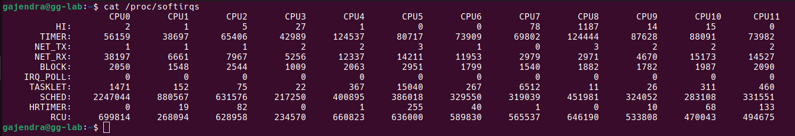

# Work deffering mechanism in linux kernel

## Introduction
* Deferringf is a mechanism in linux kernel by which a piece of work can be scheduled to be executed in the future.
* There are three different machanisms offered by the kernel
    - **Softirq**  : Executed in atomic context
    - **Tasklets** : Executed in atomic context
    - **Workqueue**: Executed in process context

## Softirq
* `softirq` stands for **software interrupt**
* `softirq` can preempt all tasks in the system execept for the hardware IRQ handlers.
    - reason for this is because `sofirq` is executed with IRQ enabled.
* These are used for high frequency threaded job scheduling.
    - Network and Block devices are the only two linux kernel subsystem that makes direct use of `softirq`.
* Eventhough `softirq` runs with interrupts enabled, they cannot sleep and any shared data needs proper locking.
* `softirq` APIs are implemented in `kernel/softirq.c`.
* To use the softirq in the drivers, the header `<linux/interrupt.h>` must be included.
* Softirqs are represented by `struct softirq_action` structures and are defined as follows:
    ```c
    struct softirq_action {
        void (*action)(struct softirq_action*);
    };
    ```
    - Thus the structure embeds a poiter to the handle that should be executed when the softirq is raised
* Thus the prototype of softirq handle should look like below
    ```c
    void softirq_handler(struct softirq_action* h);
    ```
    - running a softirq handler results in exectuion of this action function which only has one parameter: the `softirq_action` structure
* A softirq handler can be resigtered at runtime by means of `open_softirq()` function as illustrated below:
    ```c
    void open_softirq(int nr, void (*action)(struct softirq_action*));
    ``` 
    - `nr` represents the softirq index, which is also considered as softirq priority, with `0` being the highest priority.

* Possible indexes are enumerated in the code snippet below
    ```c
    enum
    {
        HI_SOFTIRQ=0,         /* High-priority tasklets */
        TIMER_SOFTIRQ,        /* Timers */
        NET_TX_SOFTIRQ,       /* Send network packets */
        NET_RX_SOFTIRQ,       /* Receive network packets */
        BLOCK_SOFTIRQ,        /* Block devices */
        BLOCK_IOPOLL_SOFTIRQ, /* Block devices with I/O polling blocked on other CPUs */
        TASKLET_SOFTIRQ,      /* Normal Priority tasklets */
        SCHED_SOFTIRQ,        /* Scheduler */
        HRTIMER_SOFTIRQ,      /* High-resolution timers */
        RCU_SOFTIRQ,          /* RCU locking */
        NR_SOFTIRQS           /* This only represent the number* of softirqs type, 10 actually */
    };
    ```
    - softirq with lower indexes have higher priority and run before those which higher indexes having lower priority.

* Name of all the available softirq in the kernel are listed in the following array
    ```c
    const char * const softirq_to_name[NR_SOFTIRQS] = {
        "HI", "TIMER", "NET_TX", "NET_RX", "BLOCK", "BLOCK_IOPOLL", "TASKLET", "SCHED", "HRTIMER", "RCU"
    };
    ```
* It is easy to check the output of the `/procs/softirqs` virtual file using the command 
    ```sh
    cat /proc/softirqs
    ```
    - On my Ubuntu 22.04 system with 12 CPU's the following output could be observed
    
    - Each number is a counter: how many times the kernel ran that type of softirq handler on that CPU since boot. It counts runs, not time spent, so one long run counts once.

* A `NR_SOFTIRQS`-entry array of struct `softirq_action` is declared in `kernel/softirq.c`, as follows:
    ```c
    static struct softirq_actoin softirq_vec[NR_SOFTIRQS];
    ```
    - Each entry in this array may contain one and only one softirq.
    - Consequently there can be a maximum of `NR_SOFITQIRQS` registered softirqs in the static array of structs of `softirq_action`.
    - Following code snippet from the `kernel/softirq.c` illustrates this:
    ```c
    //TODO
    void open_softirq(int)
    ```