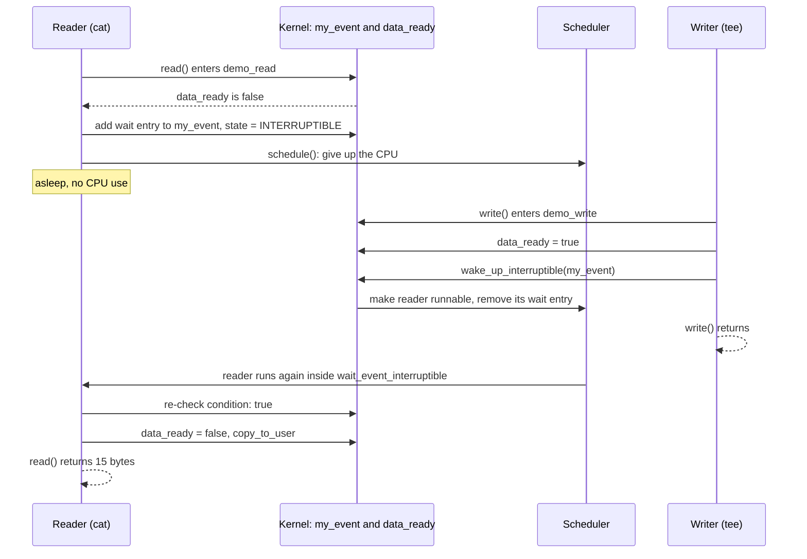

# waitq_demo exercise with `wait_queue_interruptible` and wake_interruptible
## How `waitq_demo` works under the hood

### The idea in one paragraph

The reader asks "is `data_ready` true?". If not, it adds itself to the list inside `my_event`, marks itself as sleeping and gives up the CPU, so it uses no CPU time. The writer sets `data_ready = true` and then walks the list in `my_event`, making every sleeper runnable. The reader wakes up **inside** `wait_event_interruptible()`, checks the condition again, finds it true, and carries on.

### The pieces

| Piece          | What it is                                                                                    | Where it lives                                         |
|----------------|-----------------------------------------------------------------------------------------------|--------------------------------------------------------|
| `my_event`     | Wait queue head: a spinlock plus a list of sleeping tasks                                     | Kernel module data (static, initialised at build time) |
| `data_ready`   | The condition the reader waits for                                                            | Kernel module data                                     |
| Wait entry     | One list node per sleeping task. Holds a pointer to the task and the function used to wake it | On the sleeping task's own kernel stack                |
| Reader (`cat`) | Calls `read()`, which runs `demo_read()` in the kernel on the reader's behalf                 | Process context                                        |
| Writer (`tee`) | Calls `write()`, which runs `demo_write()` in the kernel on the writer's behalf               | Process context                                        |
| Scheduler      | Decides which task gets a CPU. Sleeping tasks are not on its run queue                        | Core kernel                                            |

Layout of the wait queue while the reader sleeps:

```
my_event  (wait_queue_head_t)
 |-- lock : spinlock protecting the list (taken with IRQs off, so wake_up is IRQ-safe)
 `-- head : list_head
        `--> [ wait entry of "cat" ]
               private = pointer to cat's task_struct
               func    = autoremove_wake_function
```

### Step by step

**1. `insmod`.** `demo_init()` calls `misc_register()`. The kernel picks a minor number, creates the character device and `udev` creates `/dev/waitq_demo`. `my_event` needs no runtime setup, because `DECLARE_WAIT_QUEUE_HEAD` initialised it at build time (unlocked, empty list).

**2. `cat /dev/waitq_demo`.** `open()` finds the device by its minor number, installs `demo_fops` on the file and takes a reference on the module. `cat` then calls `read()`, and the kernel runs `demo_read()` **on cat's behalf, in cat's own context**. Inside the kernel, `current` is the `cat` task, which is why `pr_info("pid %d (%s)", current->pid, current->comm)` prints cat's PID.

**3. The reader goes to sleep.** `data_ready` is false, so `demo_read()` calls `wait_event_interruptible(my_event, READ_ONCE(data_ready))`. The macro expands to roughly this loop (simplified):

```c
struct wait_queue_entry entry;            /* lives on cat's kernel stack */
init_wait_entry(&entry, 0);               /* private = current, func = autoremove_wake_function */

for (;;) {
    /* take my_event.lock; if a signal is pending return -ERESTARTSYS;
       otherwise add 'entry' to the list and set state = TASK_INTERRUPTIBLE */
    long sig = prepare_to_wait_event(&my_event, &entry, TASK_INTERRUPTIBLE);

    if (READ_ONCE(data_ready))            /* condition checked AFTER queueing + state change */
        break;                            /* result is 0 */
    if (sig) {                             /* a signal is pending */
        ret = sig;                        /* -ERESTARTSYS */
        goto out;
    }
    schedule();                           /* sleep: leave the CPU until someone wakes us */
}
finish_wait(&my_event, &entry);           /* state = TASK_RUNNING, remove entry if still queued */
```

`schedule()` is the call that actually puts the task to sleep. Because the task state is not `TASK_RUNNING`, the scheduler takes it off the run queue and runs something else. `ps` shows state `S`, and `top` shows 0% CPU.

**4. `echo hi | sudo tee /dev/waitq_demo`.** `tee` calls `write()`, and the kernel runs `demo_write()` in tee's context:

1. `WRITE_ONCE(data_ready, true)` makes the condition true.
2. `wake_up_interruptible(&my_event)` takes `my_event.lock` and walks the list. For each entry it calls the entry's `func`. `autoremove_wake_function()` leads to `try_to_wake_up()`, which checks that the task's state matches `TASK_INTERRUPTIBLE`, sets it to `TASK_RUNNING`, puts it on a run queue (possibly on another CPU) and then removes the entry from the list.
3. `demo_write()` logs and returns. `tee` finishes.

**5. The reader wakes up.** The scheduler runs `cat` again. It resumes **inside the macro, right after `schedule()`**, and the loop goes round: it re-queues, re-checks `data_ready`, finds it true and breaks out. `finish_wait()` cleans up and the macro evaluates to `0`.

**6. The reader finishes the syscall.** `demo_read()` logs "woke up", clears `data_ready` (consumes the event), copies the 15-byte message to user space and returns 15. `cat` prints `event happened` and calls `read()` again, which blocks again.

### Sequence diagram



### Reader state over time

| Moment                                              | Reader task state    | On `my_event` list? | Uses CPU?                   |
|-----------------------------------------------------|----------------------|---------------------|-----------------------------|
| Running `demo_read()`, before waiting               | `TASK_RUNNING`       | No                  | Yes                         |
| Inside `wait_event_interruptible()`, after queueing | `TASK_INTERRUPTIBLE` | Yes                 | Briefly, until `schedule()` |
| Sleeping                                            | `TASK_INTERRUPTIBLE` | Yes                 | No (not on a run queue)     |
| After `wake_up_interruptible()`                     | `TASK_RUNNING`       | No (entry removed)  | Waits for a CPU, then yes   |
| Back in `demo_read()`                               | `TASK_RUNNING`       | No                  | Yes                         |

### Why it is correct

- **No lost wake-up.** The task is queued and marked `TASK_INTERRUPTIBLE` **before** the condition is checked. If the writer sets the flag and wakes between the check and the sleep, the wake-up finds the task already marked as sleeping, so it just makes it runnable again and `schedule()` returns at once.
- **Condition first, then wake.** The writer sets `data_ready` before `wake_up_interruptible()`, so any task it wakes sees `true` when it re-checks.
- **The loop handles bad wake-ups.** A wake-up with the condition still false, or an event taken by someone else, just sends the task back to sleep.
- **`READ_ONCE` / `WRITE_ONCE`** force a real memory access each time, so the compiler cannot keep `data_ready` in a register inside the loop. The ordering guarantees come from the wait queue lock and from `set_current_state()` and `try_to_wake_up()`, which include memory barriers.

### Edge cases

| Situation                                        | What happens                                                                                                                                                    |
|--------------------------------------------------|-----------------------------------------------------------------------------------------------------------------------------------------------------------------|
| Write happens before the read                    | `data_ready` is already `true`, so `demo_read()` skips the wait and returns the message at once. The event is not lost, because the flag keeps it.              |
| `wake_up_interruptible()` but flag still `false` | The reader wakes, re-checks, finds the condition false and sleeps again. Your code after the macro never runs.                                                  |
| Flag set but no `wake_up_interruptible()`        | A reader that is already asleep stays asleep. A reader that starts later returns at once.                                                                       |
| Ctrl+C while the reader sleeps                   | The signal wakes it, `prepare_to_wait_event()` reports a pending signal, the macro returns `-ERESTARTSYS`, `demo_read()` returns it, and the process then dies. |
| `cat` after one message                          | `cat` calls `read()` again. The flag is `false` now, so it sleeps for the next event. That is why `cat` does not exit.                                          |
| Opened with `O_NONBLOCK`                         | `demo_read()` returns `-EAGAIN` instead of sleeping.                                                                                                            |
| Two readers at once                              | Both wake on one event and race for it. The demo has a single flag and no lock, so it is for one reader only.                                                   |
| `rmmod` while a reader sleeps                    | Fails with "in use", because `.owner = THIS_MODULE` makes the open file hold a module reference.                                                                |

### What to look at on your machine

Run the reader in terminal 1 (`sudo cat /dev/waitq_demo`), then in terminal 2:

```bash
ps -o pid,stat,cmd -C cat                  # STAT = S (interruptible sleep)
sudo cat /proc/$(pgrep -n -x cat)/stack    # kernel stack of the sleeping reader
sudo dmesg | tail
```

The kernel stack should show `demo_read` near the `schedule` frames, on top of `vfs_read` and `ksys_read`. The exact frame names depend on your kernel, so treat that as what to look for, not as exact output. The log should look like this, and the last two lines can appear in either order because they run on different CPUs:

```
waitq_demo: loaded, use /dev/waitq_demo
waitq_demo: pid 2301 (cat) goes to sleep
waitq_demo: event signalled by pid 2310 (tee)
waitq_demo: pid 2301 (cat) woke up
```

### Limits of the demo

- One global flag and no lock, so it supports one reader at a time.
- `data_ready` is a one-shot event, not a queue. Two writes before a read still produce one message.
- A real driver would keep the flag and the wait queue in a per-device structure, initialised with `init_waitqueue_head()`, and protect shared state with a spinlock or mutex.

## Steps to test
* **Warning**: test on VM only. If your productive system breaks, then you are solely responsible
* Build the example: execute `make`
* Load the module : `sudo insmod waitq_demo.ko`
* Open three terminals:
    - On termial 1: execute the following to continuously montor kernel logs
        `sudo dmesg -W     # --follow-new: only new messages, skips the existing backlog`
    - On terminal 1 execute the following to block the terminal
    ```sh
    sudo cat/dev/waitq_demo
    ```
    - On terminal 2 send a message which wakes the blocked terminal 1 and prints "event happend"
    ```sh
    echo hi | sudo tee /dev/waitq_demo
    ```
    - **NOTE** the terminal still remains blocked
    * terminal 3 (while the terminal is still blocked) execute
    ```sh
    ps -o pid,stat,cmd -C cat    # STAT should be s (interruptible sleep)
    
    sudo dmesg | tail
    ```

## Why does `cat` sleep again after every wake-up?
* `cat` calls `read()` in a loop until it returns `0` (EOF) or an error.
* `demo_read()` returns 15 bytes, so `cat` prints them and calls `read()` again.
* The first read consumed the event (`data_ready = false`), so the second `read()` sleeps in `wait_event_interruptible()` until the next `write()`.
* The driver never returns `0`, so `cat` never sees EOF. This is normal for blocking stream devices (tty, input devices, FIFOs with a writer).
* Two different "sleep again" cases:
  - Inside the macro: woken, condition still false, loop and `schedule()` again. `demo_read()` does not return.
  - Outside: `demo_read()` returned, `cat` issued a new blocking `read()`.
* One-shot reads: use `head -n 1` or `dd bs=64 count=1`, or make the driver return `0` when `*ppos != 0` and advance `*ppos` after delivering the message.
* Check with: `sudo strace -e trace=read cat /dev/waitq_demo`.